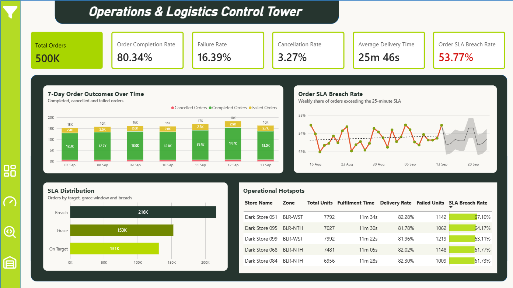
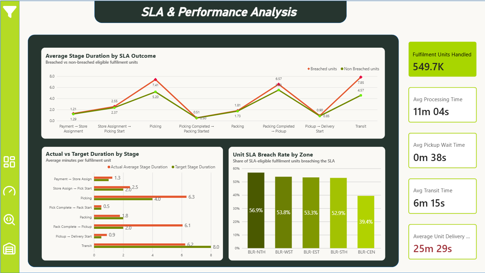
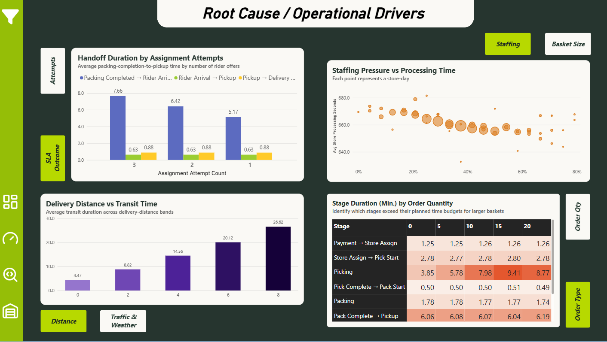
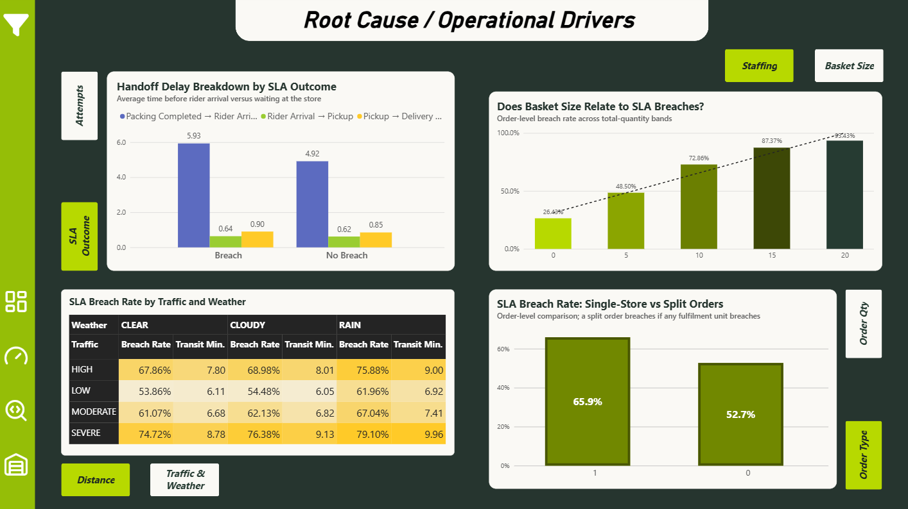
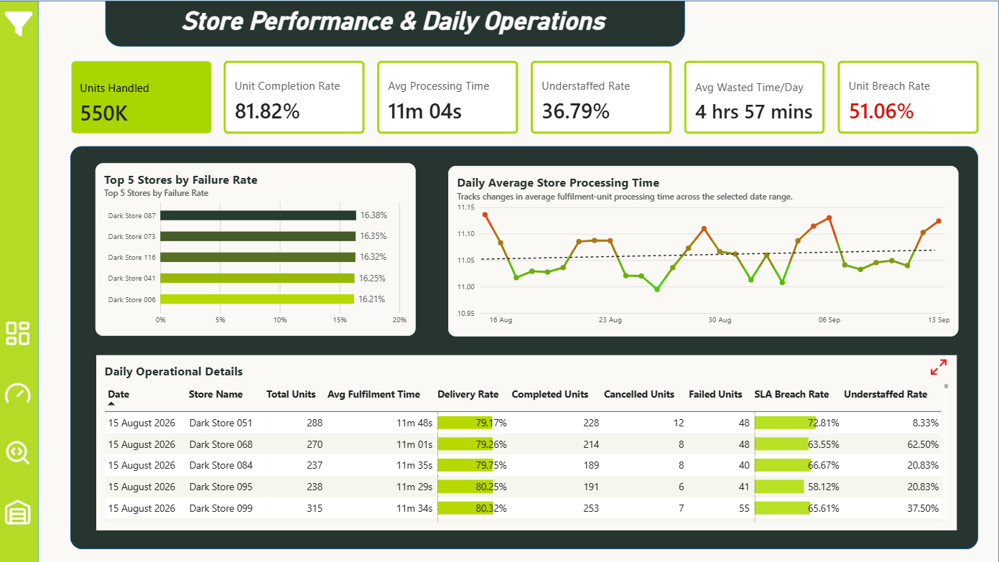
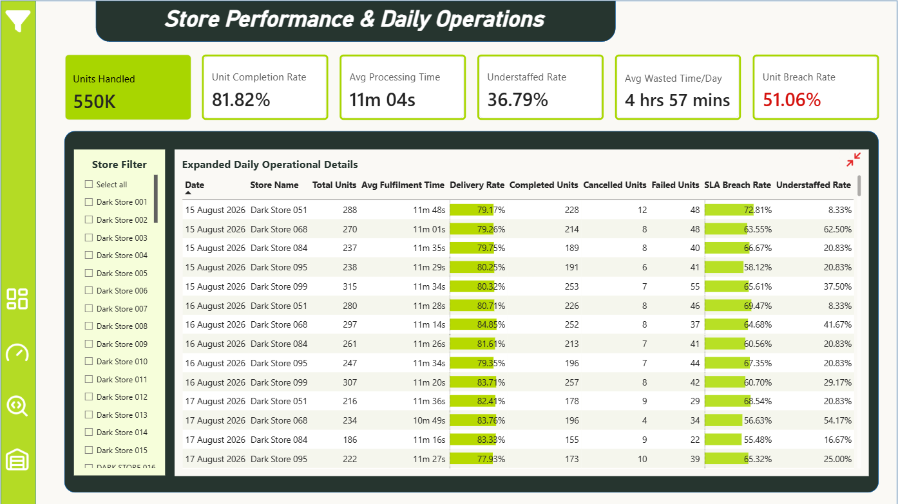

# Quick-Commerce Operations Command Center

An end-to-end analytics engineering project that uses **Python, BigQuery, dbt Core, and Power BI** to investigate delivery SLA breaches in a quick-commerce operation. The project transforms operational records into a dimensional analytical model and uses the resulting dashboard to identify where delivery time accumulates, which operating conditions are associated with poor outcomes, and which stores warrant closer investigation.

## Business Problem

A delivery SLA breach is an outcome, not an explanation. To investigate it, an operations team needs to distinguish between time spent waiting for store assignment, picking and packing, waiting for a rider to arrive, and last-mile transit. It also needs to compare performance across order sizes, assignment attempts, route conditions, and stores without accidentally mixing metrics calculated at different levels of detail.

This project was built around four practical questions:

1. **How is the operation performing?** What are the order outcomes, average delivery times, and SLA breach trends?
2. **Where does time accumulate?** Which fulfilment and delivery stages exceed their planned durations?
3. **What conditions are associated with breaches?** How do basket quantity, rider assignment attempts, distance, traffic, weather, and staffing relate to operational performance?
4. **Where should an investigation start?** Which stores and store-days have higher failure rates or operational pressure?

The goal is to create an analytical workflow for diagnosis and prioritisation—not to claim that the dashboard proves causality or automatically identifies the correct intervention.

## SLA Definition

The project uses the following operating rules:

| Rule | Definition |
|---|---|
| SLA clock starts | Payment success |
| Target delivery time | 20 minutes |
| Grace window | 5 additional minutes |
| On target | Delivery time `<= 20 minutes` |
| Grace window | Delivery time `> 20` and `<= 25 minutes` |
| SLA breach | Delivery time `> 25 minutes` |
| Split order | If any fulfilment portion breaches or fails, the parent order is treated conservatively |

These are **project-defined operating assumptions**, not verified industry benchmarks.

## Architecture

```text
       RAW Data Source
              |
              v
     BigQuery RAW layer
   (source representation)
              |
              v
       dbt STAGING
 (profiling-led cleaning,
 typing, standardisation,
       deduplication)
              |
              v
    dbt INTERMEDIATE
 (reusable lifecycle and
   duration calculations)
              |
              v
        dbt MARTS
 (dimensions, detailed facts,
    daily aggregate facts)
              |
              v
          Power BI
 (overview, stage analysis,
  driver exploration, store detail)
```

BigQuery performs the warehouse computation; dbt manages the SQL transformations and model dependencies. The final MARTS layer is designed for reporting, while the earlier layers keep source data, cleaning rules, and reusable operational logic separate.

## Data Model

The source model contains ten related operational tables. The final analytical layer preserves different business grains rather than flattening every process into one table.

### Source tables

| Source table | Grain / purpose |
|---|---|
| `customers` | One row per customer; minimal customer and geographic reference |
| `stores` | One row per dark store |
| `riders` | One row per registered rider |
| `orders` | One row per customer order |
| `fulfilment_units` | One row per store-specific fulfilment portion; supports split orders |
| `order_items` | One row per order item line; provides basket workload |
| `deliveries` | One row per delivery operation and its lifecycle |
| `rider_assignments` | One row per rider offer/response attempt |
| `operational_events` | One row per significant operational event |
| `store_staffing` | One row per store/hour staffing observation |

### Final MARTS models

| Model | Grain | Role |
|---|---|---|
| `dim_date` | One row per calendar date | Common calendar filtering and grouping |
| `dim_store` | One row per store | Store attributes and filtering |
| `dim_rider` | One row per rider | Rider attributes and filtering |
| `fact_orders` | One row per order | Order outcomes, split-order indicators, item and quantity summaries, order-level measures |
| `fact_fulfilment_units` | One row per fulfilment unit | Central operational fact containing store fulfilment, delivery lifecycle, stage durations, and outcome flags |
| `fact_rider_assignments` | One row per rider assignment attempt | Assignment response and retry analysis |
| `fact_store_staffing` | One row per staffing snapshot | Detailed staffing context |
| `fact_store_daily` | One row per store per date | Store workload, outcomes, SLA, processing and staffing summaries |
| `fact_rider_daily` | One row per rider per date | Daily rider assignment and delivery performance |

The `fact_fulfilment_units` model combines fulfilment and delivery lifecycle data with a **LEFT JOIN**. This preserves fulfilment units that were cancelled or failed before a delivery record existed. Order-level, fulfilment-unit-level, assignment-attempt-level, and store-day-level measures remain conceptually distinct.

The original plan was to use Looker Studio for reporting. During implementation, the visualization layer was changed to Power BI; the final report uses Power BI over the BigQuery MARTS layer.

## Data Transformation Approach

### RAW — preserve source representation

The RAW layer was used as the landing area for the simulated source data. It was not treated as a cleaning layer. This made the original formatting problems visible and allowed the cleaning rules to be implemented and repeated in dbt rather than hidden during ingestion.

### STAGING — clean and standardise

The ten staging models are materialised as views. The transformations were informed by profiling of row counts, nulls and blanks, distinct values, duplicates, whitespace, character patterns, numeric convertibility, and timestamp formats.

Key decisions included:

- Trim surrounding whitespace and standardise controlled code/category fields where profiling justified it.
- Convert blank and literal `NULL` representations to SQL `NULL` where appropriate.
- Use `SAFE_CAST` for source fields that require numeric types so malformed inputs can be identified instead of aborting a model.
- Parse observed timestamp formats explicitly and preserve timestamps as timestamps where event order and time-of-day matter.
- Deduplicate by the declared business grain using keys and `ROW_NUMBER()`, rather than applying an indiscriminate `DISTINCT` to every table.
- Keep RAW unchanged; standardisation and deduplication happen downstream.

The final staging row counts matched the expected distinct grain-key counts, with no unexplained record loss identified.

| Table | RAW rows | STAGING rows |
|---|---:|---:|
| `customers` | 1,009,941 | 1,000,000 |
| `stores` | 120 | 120 |
| `riders` | 2,022 | 2,000 |
| `orders` | 505,029 | 500,000 |
| `fulfilment_units` | 555,134 | 549,732 |
| `order_items` | 2,068,619 | 2,048,235 |
| `deliveries` | 555,292 | 549,732 |
| `rider_assignments` | 648,949 | 642,570 |
| `operational_events` | 6,125,351 | 6,064,852 |
| `store_staffing` | 87,253 | 86,400 |

### INTERMEDIATE — derive operational logic

The intermediate layer was initially explored with several process/entity models. As the MARTS design became clearer, it was reduced to two reusable views:

- `int_fulfilment_units`
- `int_deliveries`

These contain lifecycle and duration logic that remains useful to the final analytical model. Other transformations were moved directly into MARTS where a separate intermediate model did not provide enough reuse to justify another layer. No separate `int_operational_events` model was created; the event log remains available for validation, audit and future event-sequence analysis.

Invalid timestamp-derived durations are returned as `NULL` when the end timestamp precedes the start timestamp. The project does not silently convert negative durations to zero or invent replacement timestamps, because that would confuse invalid/unavailable duration with a genuine zero-second duration.

### MARTS — model for analysis

The final MARTS layer uses descriptive dimensions, detailed facts and daily aggregate facts. `fact_store_daily` and `fact_rider_daily` provide recurring operational summaries, while the atomic facts retain the detail needed for deeper analysis. The model is designed to support common date/store/rider slicing without treating fact tables at different grains as interchangeable.

## Power BI Dashboard

The dashboard is organised as a four-page investigation flow: **monitor → diagnose stages → explore associated drivers → inspect stores and dates**. The pages are designed to answer different questions rather than repeat the same KPI set on multiple pages.

### Dashboard snapshots

#### 1. Operations Overview

Purpose: establish the scale and outcome mix of the operation, monitor the SLA trend, and surface stores for follow-up.



#### 2. SLA & Performance Analysis

Purpose: compare the duration of each operational stage for breached and non-breached fulfilment units, compare actual stage averages against project targets, and compare unit-level breach rates by zone.



#### 3. Root Cause / Operational Drivers — assignment, staffing and distance view

Purpose: explore how assignment-attempt count relates to the pre-pickup handoff, examine store-day staffing versus processing time, and compare distance bands with transit time.



#### 4. Root Cause / Operational Drivers — SLA outcome, basket size and conditions view

Purpose: compare handoff stages by SLA outcome, explore basket-size relationships, compare traffic/weather combinations, and examine differences between single-store and split orders.



#### 5. Store Performance — overview

Purpose: compare the highest store failure rates, track daily average store-processing time, and review store-day operations in a compact table.



#### 6. Store Performance — expanded daily detail

Purpose: filter to selected stores and inspect daily workload, outcomes, processing time, SLA breach rate and understaffing measures.



## Key Findings From the Current Dashboard

The following are findings from the current simulated dataset and report state. They should be interpreted as descriptive patterns, not as verified real-world benchmarks or causal proof.

### Network-level performance

- **500K orders** are represented in the overview.
- Order completion is **80.34%**, failure is **16.39%**, and cancellation is **3.27%**. These three displayed rates sum to 100% when treated as mutually exclusive outcomes.
- Average order delivery time is **25m 46s**.
- The displayed order SLA breach KPI is **53.77%**; the unit-level breach KPI is **51.06%**.
- Approximately **549.7K fulfilment units** are represented. This exceeding the order count is consistent with the model allowing split fulfilment.

### Stage-level performance

The most visible overruns against the project's internal stage targets are:

| Stage | Actual average | Project target | Reading |
|---|---:|---:|---|
| Payment → store assignment | 1.3 min | 1.0 min | Small overrun |
| Store assignment → picking start | 2.5 min | 2.0 min | Modest delay before picking |
| Picking | 6.3 min | 4.0 min | Material overrun; average time also rises across larger quantity bands |
| Picking complete → packing start | 0.5 min | 0.5 min | Approximately on target |
| Packing | 1.8 min | 2.0 min | Below the project target |
| Packing complete → pickup | 6.1 min | 2.0 min | Largest displayed absolute overrun |
| Pickup → delivery start | 0.9 min | 0.5 min | Small-to-moderate overrun |
| Transit | 6.2 min | 8.0 min | Below the project target on average |

The **Packing Completed → Pickup** interval averages **6.1 minutes**, exceeding the project's internal 2-minute target. The Root Cause page decomposes this total into **Packing Completed → Rider Arrival** and **Rider Arrival → Pickup**. The pre-arrival interval rises from **5.17 minutes with one assignment attempt** to **7.66 minutes with three attempts**, while rider-arrival-to-pickup remains around **0.63 minutes**. This indicates that most of the measured elapsed time in the combined interval accumulates before rider arrival, and that more assignment attempts are associated with a longer pre-arrival interval. Label the first component **Packing Completed → Rider Arrival** rather than **Packing → Rider Arrival** so the metric's start point is explicit. Because the project has no defined rider-arrival deadline, describe this as a long pre-arrival interval—not as a proven late arrival against a target. The target-comparison chart retains the combined interval because the existing 2-minute target applies to **Packing Completed → Pickup**; the pre-arrival component is used for diagnosis on Page 3 rather than compared with an invented target.

### Operational factors to investigate

- **Basket quantity:** the displayed order breach rate rises across quantity bands, from **26.42%** at the band labelled `0` to **95.43%** at the band labelled `20`. Picking time also increases across most of these bands. Validate the band definitions, sample sizes, and split-order effect before interpreting this as an independent basket-size effect.
- **Distance:** average transit time increases across the displayed distance bands, from **4.47 minutes** at label `0` to **26.62 minutes** at label `8`. Confirm the units, band definitions and sample count in the highest band.
- **Traffic and weather:** higher breach rates and transit times appear in more adverse traffic/weather combinations. These are associations that can guide investigation, not evidence of independent causal effects.
- **Store operations:** average store-processing time is **11m 04s** and the reported understaffed snapshot rate is **36.79%**. The daily average processing-time line is relatively stable around 11 minutes; the five highest store failure rates are tightly grouped at approximately **16.21%–16.38%**.
- **Split orders:** the displayed order-level breach rate is **65.9%** for one category and **52.7%** for the other. The visual currently uses `1` and `0`; verify which category means split orders and label the axis descriptively. A split order also has more than one opportunity for at least one fulfilment unit to breach under the conservative parent-order rule.

## Project Timeline and Design Decisions

1. **Architecture and setup:** initialised the Git repository and Python environment, created the simulator package foundation, configured dbt Core and the BigQuery adapter, authenticated through OAuth, and verified the connection to BigQuery in `asia-south1`.
2. **Operational source model and simulator:** designed connected source entities, split fulfilment and lifecycle timestamps; defined the 20-minute target plus five-minute grace rule; validated the clean generated baseline; and created a separate copy with technical source-format issues for staging practice.
3. **Staging layer:** profiled the raw source, then implemented source-aware parsing, type conversion, standardisation and grain-based deduplication as dbt views. Row counts were checked against distinct business keys.
4. **Intermediate layer:** developed reusable duration and lifecycle logic, handled invalid durations explicitly, and explored partitioning/clustering where appropriate. During later modeling, reduced the layer to the two reusable fulfilment/delivery views that remained valuable to MARTS.
5. **MARTS layer:** replaced the initial idea of using several summary tables with a defined dimensional analytical model. Preserved order, fulfilment-unit, assignment-attempt and staffing grains; added store-day and rider-day aggregate facts; and retained a LEFT JOIN so early failed/cancelled units were not lost.
6. **Power BI:** switched from the initially planned Looker Studio visualisation to Power BI, then created the four-page dashboard around overview, stage diagnosis, driver exploration, and store-level investigation.

## Technology Stack

- **Python 3.11** — operational-data simulator
- **uv** — Python environment and dependency management
- **dbt Core + dbt-bigquery** — SQL transformation workflow, model dependencies and warehouse-layer organisation
- **Google BigQuery** — cloud data warehouse and SQL execution
- **Power BI Desktop** — dashboard, measures, filtering, drill-down and visual analysis
- **Git / GitHub** — source control


##
> **Note for Reviewers:** All tables in the Power BI dashboard (`BI File/`) are loaded in **Import mode** with the complete analytical dataset already embedded. You can open and explore the `.pbix` file directly in Power BI Desktop without setting up BigQuery, running local SQL transformations, or executing the Python data generation pipeline. The setup steps below are only required if you wish to reproduce or rebuild the upstream data warehouse.
##


## Scope and Limitations

- The dashboard is an operational analytics project, not a sales or revenue analysis. It does not currently measure revenue, margin, inventory availability, customer acquisition, or financial impact.
- The analysis identifies patterns that can prioritise investigation; it does not prove causality, optimise staffing schedules, or prescribe a tested intervention.
- SLA and stage targets are assumptions defined for this project.
- The project demonstrates an end-to-end learning workflow, not a production deployment or a statistically representative model of a real company.

## Data Note

A suitable public dataset was not available for the intended quick-commerce lifecycle. The project therefore uses a **synthetically generated, relationally connected operational dataset** to exercise the BigQuery, dbt, data-quality, dimensional-modeling and dashboard workflow. The records are illustrative and do not represent a real company or industry benchmark.